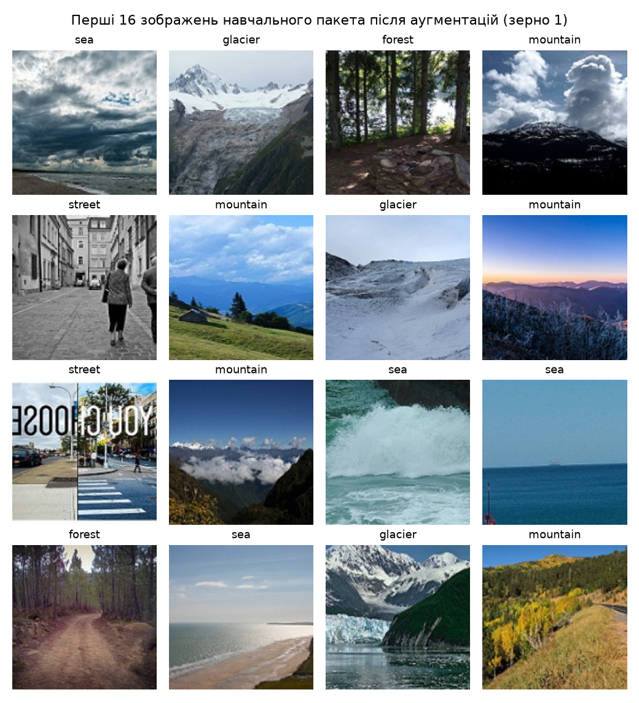
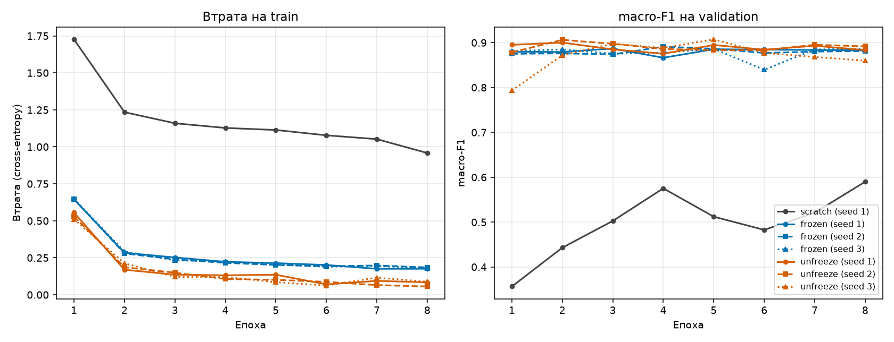
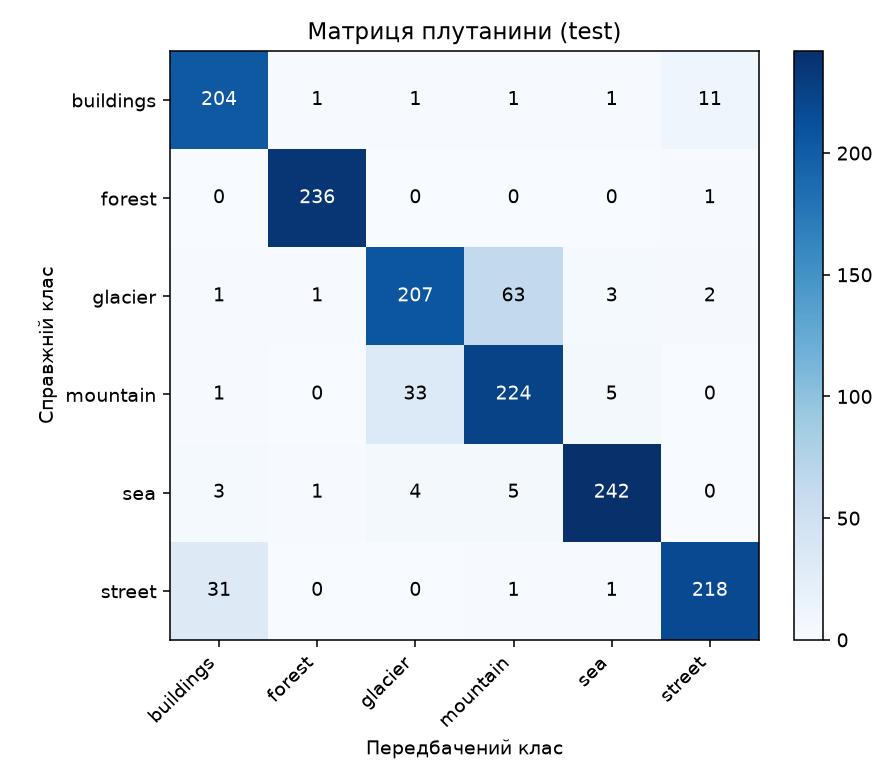
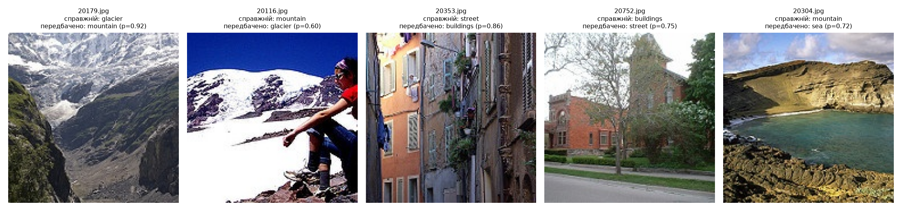

# ЛР3. Обчислювальний експеримент і трансферне навчання (ResNet-18)

Порівнюємо три режими навчання ResNet-18 на малій вибірці (1200 зображень, 6 класів) за **однакового бюджету в 304 кроки оптимізатора** та відповідаємо на питання роботи:

* яку частину виграшу дають **попередньо навчені ознаки** (ефект $\Delta_{\text{pre}}$);
* яку частину дає **донавчання кістяка** під нову задачу (ефект $\Delta_{\text{unf}}$);
* чи кожна з цих різниць більша за **розкид між запусками** ($R$).

Набір даних: [Intel Image Classification](https://www.kaggle.com/datasets/puneet6060/intel-image-classification) (використано лише `seg_train` і `seg_test`; `seg_pred` та самі зображення в репозиторій не додано).

## Зміст

1. [Структура репозиторію та запуск](#1-структура-репозиторію-та-запуск)
2. [Що саме реалізовано](#2-що-саме-реалізовано)
3. [Перевірки до навчання (п. 1)](#3-перевірки-до-навчання-п-1)
4. [Перевірка режимів навчання (п. 2)](#4-перевірка-режимів-навчання-п-2)
5. [Сім запусків (п. 3)](#5-сім-запусків-п-3)
6. [Розклад ефектів (п. 4)](#6-розклад-ефектів-п-4)
7. [Вибір конфігурації і тестова оцінка (п. 5)](#7-вибір-конфігурації-і-тестова-оцінка-п-5)
8. [Висновок (п. 6)](#8-висновок-п-6)
9. [Відтворюваність і відхилення від умови](#9-відтворюваність-і-відхилення-від-умови)
10. [Використання генеративних інструментів і зовнішніх джерел](#10-використання-генеративних-інструментів-і-зовнішніх-джерел)

---

## 1. Структура репозиторію та запуск

```
lab3/
├── common.py          # константи, поділ, перетворення, модель, режими, set_train_mode, метрики
├── checks.py          # перевірки пунктів 1–2 (поділ, пакет, L0, параметри, стани, дослід із BN)
├── train.py           # команда навчання (поділ, перевірки, 7 запусків, журнали, вибір, lab3_model.pt)
├── analyze.py         # команда аналізу (хеш split.csv, таблиця, криві, ефекти, вибір, тест, помилки)
├── pyproject.toml     # залежності із зафіксованими версіями (python 3.12)
├── uv.lock            # повний lock-файл
├── split.csv          # поділ: file, label, part (4200 рядків)
├── lab3_model.pt      # ваги вибраного запуску (≈ 45 МБ)
├── runs/<режим>_seed<зерно>/   # run.json + val_logits.npy для кожного з 7 запусків
├── checks/            # checks.md / checks.json - результати перевірок пунктів 1–2
├── results/           # analysis.md / analysis.json / test_logits.npy - вихід команди аналізу
├── figures/           # train_batch.png, curves.png, confusion_matrix.png, top5_errors.png
├── train_log.txt      # повний консольний вивід команди навчання
└── analyze_log.txt    # повний консольний вивід команди аналізу
```

Дві команди (обидві приймають шлях до локальної копії набору - теки, у якій лежать `seg_train/seg_train` та `seg_test/seg_test`):

```bash
# 1) навчання: поділ, перевірки пунктів 1-2, сім запусків, журнали, вибір, lab3_model.pt (test не використовується)
uv run python train.py --data-dir <шлях до набору>

# 2) аналіз: хеш split.csv, таблиця, криві, ефекти, перевірка вибору, тестова оцінка, матриця плутанини, п'ять помилок
uv run python analyze.py --data-dir <шлях до набору>
```

Ваги окремих запусків (`runs/*/weights.pt`, ≈ 43 МБ кожні) зберігаються локально і виключені через `.gitignore`; у репозиторій потрапляє лише вибраний `lab3_model.pt`.

---

## 2. Що саме реалізовано

**Поділ.** Для кожного класу беремо імена файлів, відсортовані як рядки (`sorted()`). Для train один `np.random.default_rng(0)` на всі класи по черзі: `idx = np.arange(n_k)`, `rng.shuffle(idx)`, у train - файли `idx[:200]`. Для validation/test - новий `default_rng(0)` на всі класи seg_test: `cut = n_k // 2`, validation - `idx[:cut]`, test - `idx[cut:]`. Результат (1200 / 1498 / 1502 зображення) записано в `split.csv` (стовпці `file`, `label`, `part`); усі дані далі завантажуються лише за ним. Файл пишеться з `\n` як роздільником рядків, щоб його SHA-256 не залежав від ОС.

**Перетворення.** train: `RandomResizedCrop(160, scale=(0.7, 1.0))` → `RandomHorizontalFlip()` → `ToTensor()` → `Normalize(mean, std)`; validation/test: `Resize((160, 160))` → `ToTensor()` → `Normalize(mean, std)`; $\text{mean}=(0.485,\,0.456,\,0.406)$, $\text{std}=(0.229,\,0.224,\,0.225)$. Зображення відкриваються через Pillow з `.convert("RGB")`.

**Модель і режими.** Кожен запуск: `torch.manual_seed(seed)` + `np.random.seed(seed)` → `resnet18(weights=W)` → `model.fc = Linear(512, 6)` → `requires_grad=False` для всього, що не навчається → перенесення на пристрій → `AdamW(weight_decay=1e-4)`.

| Режим | Ваги | Що навчається | Параметрів | Групи AdamW (lr) | У `eval()` під час навчання |
|---|---|---|---|---|---|
| scratch | випадкові | уся мережа | 11 179 590 | усі параметри, $3\cdot10^{-3}$ | - |
| frozen | ImageNet | `fc` | 3 078 | `fc`, $3\cdot10^{-3}$ | `conv1`, `bn1`, `layer1`–`layer4` |
| unfreeze | ImageNet | `layer4`, `fc` | 8 396 806 | `fc`, $3\cdot10^{-3}$; `layer4`, $3\cdot10^{-4}$ | `conv1`, `bn1`, `layer1`–`layer3` |

Функція `set_train_mode(model, regime)` викликається на початку кожної епохи: `model.train()`, а потім `.eval()` для модулів зі стовпця «У `eval()`».

**Цикл навчання.** 8 епох $\times$ 38 пакетів = **304 кроки**; train-завантажувач: `batch_size=32`, `shuffle=True`, `drop_last=False`, `num_workers=0`, без власного генератора (випадковість береться з глобального генератора PyTorch); останній пакет епохи має 16 зображень. Функція втрат - `CrossEntropyLoss()` (середнє за пакетом). Не використовуються: розклади lr, обрізання градієнта, змішана точність, згладжування міток, ваги класів, рання зупинка, вибір епохи за validation.

**Метрики.** Втрата епохи (з урахуванням меншого останнього пакета; $L_b$ - втрата пакета $b$ до кроку оптимізатора, $|b|$ - його розмір):

$$L_{\text{epoch}}=\frac{\sum_{b} L_b\,|b|}{1200}.$$

Для кожного класу $k$ розглядаємо його проти решти:

$$F1_k=\frac{2\,TP_k}{2\,TP_k+FP_k+FN_k},\qquad \text{macro-}F1=\frac{1}{6}\sum_{k=0}^{5}F1_k .$$

Підсумок запуску $F_{r,s}$ - macro-$F1$ на validation після 8-ї епохи для режиму $r$ і зерна $s$ (використовуються ваги після 8-ї епохи). Обчислення - `sklearn.metrics.f1_score(average="macro")`.

---

## 3. Перевірки до навчання (п. 1)

### 3.1. Поділ

Кожна клітинка - «кількість / сума числових імен файлів». Усі 18 клітинок і три підсумкові рядки **збігаються** з контрольною таблицею з умови (✓).

| Клас | train | validation | test |
|---|---|---|---|
| buildings | 200 / 1 996 761 ✓ | 218 / 4 837 323 ✓ | 219 / 4 837 559 ✓ |
| forest | 200 / 2 032 625 ✓ | 237 / 5 276 962 ✓ | 237 / 5 291 326 ✓ |
| glacier | 200 / 2 183 923 ✓ | 276 / 6 135 652 ✓ | 277 / 6 157 250 ✓ |
| mountain | 200 / 1 950 345 ✓ | 262 / 5 789 535 ✓ | 263 / 5 849 765 ✓ |
| sea | 200 / 1 987 613 ✓ | 255 / 5 655 068 ✓ | 255 / 5 668 011 ✓ |
| street | 200 / 1 841 817 ✓ | 250 / 5 541 845 ✓ | 251 / 5 547 533 ✓ |
| **Разом** | **1200 / 11 993 084 ✓** | **1498 / 33 236 385 ✓** | **1502 / 33 351 444 ✓** |

Жоден файл не входить у дві частини: у `split.csv` 4200 рядків і 4200 **унікальних** імен файлів, перетини train∩validation, train∩test, validation∩test порожні. Команда `train.py` зупиняється з помилкою, якщо хоч одна клітинка не збігається.

SHA-256 `split.csv`: `d3a611aec41f6e335ab58287f10a443f3e0e35aa9adfefae662d48b15af567f9` (однаковий у всіх семи журналах).

### 3.2. Пакет після перетворень

Перші 16 зображень першого навчального пакета (зерно 1) у тому вигляді, в якому їх отримує модель: після `RandomResizedCrop` і `RandomHorizontalFlip`, з оберненим нормуванням ($x\cdot\text{std}+\text{mean}$), мітка над кожним зображенням. Дзеркальний напис на зображенні `street` (3-й рядок, 1-й стовпець) - наочний слід `RandomHorizontalFlip`.



### 3.3. Початкова втрата $L_0$

Модель побудовано за кроками 1–5 зі зерном 1; $L_0$ - втрата на першому пакеті навчального завантажувача **до жодного кроку оптимізатора**, після `set_train_mode`, під `torch.no_grad()` (цей екземпляр моделі далі не використовується, бо прямий прохід у режимі train оновлює ковзні статистики BN).

| Режим | $L_0$ | $\ln 6$ | $L_0-\ln 6$ |
|---|---|---|---|
| scratch | 2.1344 | 1.7918 | +0.343 |
| frozen | 2.2155 | 1.7918 | +0.424 |

$\ln 6\approx1.792$ - втрата моделі, що дає всім шести класам однакову ймовірність $1/6$. Обидва значення **трохи вищі**, і це очікувано, а не помилка: ініціалізація `fc` випадкова, тому логіти не рівні, а мають розсіяння. На цьому ж пакеті виміряно стандартне відхилення логітів: 0.50 (scratch) і 0.67 (frozen); у frozen ознаки більші за модулем (середня $L_2$-норма вектора ознак перед `fc` ≈ 27.9 проти ≈ 18.7 у scratch), тому і розсіяння, і $L_0$ більші. Втрата вгнута відносно рівномірних логітів: для логітів з розсіянням $\sigma$ середня втрата зростає приблизно на $\tfrac{\sigma^2}{2}\left(1-\tfrac{1}{6}\right)$, тобто на ~0.10 (scratch) і ~0.19 (frozen). Решту перевищення пояснює випадкове (невдале) узгодження початкових ваг `fc` з 32 конкретними мітками пакета (розподіл міток у пакеті нерівномірний: 3, 5, 5, 5, 5, 9). Тобто $L_0\approx\ln 6$ з відхиленням у межах очікуваного. Помилкою були б значення на кшталт 0 (витік міток), $\gg 3$ (неправильне нормування) або NaN.

---

## 4. Перевірка режимів навчання (п. 2)

Кожна перевірка починається з нового екземпляра моделі, побудованого за кроками 1–5 зі зерном 1. Ці моделі **не** є навчальними запусками протоколу: після 5 кроків їх не оцінюють на validation, не зберігають і не включають у таблицю п. 5.

### 4.1. Параметри і групи оптимізатора

Кількість параметрів - сума `numel()`, а не кількість тензорів. Числа збігаються з таблицею режимів; жоден параметр із `requires_grad=False` в оптимізатор не потрапив (і навпаки - усі навчальні параметри в оптимізаторі є).

| Режим | Усього параметрів | `requires_grad=True` | Групи оптимізатора (параметрів @ lr) | Заморожених параметрів в оптимізаторі | Збігається |
|---|---|---|---|---|---|
| scratch | 11 179 590 | 11 179 590 | 11 179 590 @ $3\cdot10^{-3}$ | 0 | так |
| frozen | 11 179 590 | 3 078 | 3 078 @ $3\cdot10^{-3}$ | 0 | так |
| unfreeze | 11 179 590 | 8 396 806 | 3 078 @ $3\cdot10^{-3}$; 8 393 728 @ $3\cdot10^{-4}$ | 0 | так |

(Сума груп unfreeze: $3078+8\,393\,728=8\,396\,806$; `weight_decay`=$10^{-4}$ у всіх групах.)

### 4.2. Що змінюється під час навчання

Алгоритм: копія повного `state_dict()` (параметри **і** буфери: `running_mean`, `running_var`, `num_batches_tracked`) → `set_train_mode` → 5 кроків оптимізатора на перших 5 пакетах → для кожного модуля верхнього рівня точне порівняння `torch.equal` (без допуску) параметрів і ковзних статистик BN. У scratch змінюється все, тож перевіряти там нічого.

**frozen** (очікувано: заморожено `conv1`, `bn1`, `layer1`–`layer4`; змінюється лише `fc`):

| Модуль | Параметри змінилися | Ковзні статистики BN змінилися | Збігається з очікуваним |
|---|---|---|---|
| conv1 | ні | немає BN | так |
| bn1 | ні | ні | так |
| layer1 | ні | ні | так |
| layer2 | ні | ні | так |
| layer3 | ні | ні | так |
| layer4 | ні | ні | так |
| fc | так | немає BN | так |

**unfreeze** (очікувано: заморожено `conv1`, `bn1`, `layer1`–`layer3`; змінюються `layer4` і `fc`):

| Модуль | Параметри змінилися | Ковзні статистики BN змінилися | Збігається з очікуваним |
|---|---|---|---|
| conv1 | ні | немає BN | так |
| bn1 | ні | ні | так |
| layer1 | ні | ні | так |
| layer2 | ні | ні | так |
| layer3 | ні | ні | так |
| layer4 | так | так | так |
| fc | так | немає BN | так |

Усі 14 рядків збігаються з очікуваним - до основного експерименту можна було переходити.

### 4.3. Дослід із навмисною помилкою (frozen + звичайний `model.train()`)

**Прогноз** (записано до запуску досліду; той самий текст друкується в `train_log.txt` перед результатами):

> У frozen з `model.train()` параметри кістяка **не** зміняться (`requires_grad=False`, в оптимізаторі їх немає), але ковзні статистики `running_mean`, `running_var` і лічильник `num_batches_tracked` **усіх** BN-шарів кістяка оновляться, бо BN у режимі train оновлює їх незалежно від `requires_grad` (за `momentum=0.1` за 5 кроків ≈ 41 % старої статистики замінюється статистикою нових даних, бо $1-0.9^5\approx0.41$). Голова `fc` навчатиметься як і раніше. На кривій втрати на train це майже не буде помітно: у режимі train BN нормує за статистикою самого пакета, тому втрата на train лишається схожою на правильну; наслідок проявиться лише в `eval()`, де використовуються вже зміщені ковзні статистики.

**Результат** (frozen, `model.train()`, 5 кроків):

| Модуль | Параметри змінилися | Ковзні статистики BN змінилися |
|---|---|---|
| conv1 | ні | немає BN |
| bn1 | ні | **так** |
| layer1 | ні | **так** |
| layer2 | ні | **так** |
| layer3 | ні | **так** |
| layer4 | ні | **так** |
| fc | так | немає BN |

Максимальна абсолютна зміна в шарі `layer1.0.bn1` після 5 кроків: $\max|\Delta\,\text{running\_mean}| = 8.858\cdot10^{-2}$, $\max|\Delta\,\text{running\_var}| = 1.484\cdot10^{-1}$; `num_batches_tracked` = 5.

**Зіставлення з прогнозом.** Прогноз підтвердився: параметри кістяка не змінилися ні в одному модулі, а ковзні статистики змінилися в усіх модулях із BN (`bn1`, `layer1`–`layer4`). Щодо кривої втрати: втрати на 5 кроках - з помилкою `[2.1946, 1.7303, 1.9906, 1.7364, 1.4441]`, правильно `[2.2155, 1.6835, 1.7928, 1.4501, 1.2067]`. Обидві послідовності спадають; помилковий варіант на кроках 3–5 трохи вищий (до ≈ 0.29), але це на межі пакетного шуму на 5 кроках, тож **за кривою втрати на train помилку не виявити** без еталонного запуску - це відповідає прогнозу (певна невелика різниця все ж є, тому «майже не помітно», а не «зовсім не видно»). Реальна шкода проявилася б на validation/test, де BN використовує зміщені статистики.

**Чому `requires_grad=False` не захищає ці значення.** `requires_grad` стосується *параметрів* (`weight`, `bias` у BN), для яких не рахуються градієнти й які оптимізатор не оновлює. Ковзні статистики `running_mean`/`running_var` - це *буфери*, а не параметри: вони не мають градієнтів і оновлюються не оптимізатором, а безпосередньо в прямому проході BN у режимі `train()` за правилом

$$\hat\mu \leftarrow (1-m)\,\hat\mu + m\,\mu_{\text{batch}},\qquad \hat\sigma^2 \leftarrow (1-m)\,\hat\sigma^2 + m\,\sigma^2_{\text{batch}},\qquad m=0.1 .$$

Захищає їх лише режим `eval()`, у якому BN використовує збережені статистики й не оновлює їх. Тому заморожені модулі мають бути в `eval()`: інакше (1) «заморожений» кістяк тихо перестає бути ImageNet-кістяком - його ковзні статистики дрейфують до статистик малого набору, і (2) виникає розбіжність між навчанням (нормування за статистикою пакета) та інференсом (нормування за дрейфуючими ковзними статистиками).

**Чому для `layer4` у unfreeze оновлення правильне.** У unfreeze ваги `layer4` змінюються, отже змінюється й розподіл активацій на виході його шарів. Ковзні статистики BN у `layer4` мають «наздоганяти» цей розподіл, інакше в `eval()` BN нормував би нові активації старими ImageNet-статистиками, які вже не відповідають новим вагам. Тому `layer4` лишається в режимі `train()`, а `conv1`, `bn1`, `layer1`–`layer3`, ваги яких не змінюються, - в `eval()`, зі збереженими ImageNet-статистиками.

---

## 5. Сім запусків (п. 3)

Рівно сім запусків: scratch (зерно 1), frozen (зерна 1, 2, 3), unfreeze (зерна 1, 2, 3). Налагоджувальних запусків у таблиці немає і для вибору вони не використовувалися. Для кожного запуску збережено `runs/<режим>_seed<зерно>/run.json` (зерно, усі налаштування розділів «Перетворення», «Модель і режими», «Цикл навчання», включно зі значеннями за замовчуванням; хеш коміту та позначка про незакомічені зміни; SHA-256 `split.csv`; версії Python/PyTorch/torchvision і назва пристрою; втрата train і macro-$F1$ validation за кожну епоху; час навчання) і `val_logits.npy` (масив $1498\times6$ у порядку рядків validation у `split.csv`). На test у цьому пункті нічого не обчислювалося.

| # | Режим | Зерно | Втрата train, епоха 8 | macro-$F1$ validation, епоха 8 | Час навчання, с |
|---|---|---|---|---|---|
| 1 | scratch | 1 | 0.9490 | 0.5671 | 278 |
| 2 | frozen | 1 | 0.1759 | 0.8829 | 89 |
| 3 | frozen | 2 | 0.1848 | 0.8814 | 89 |
| 4 | frozen | 3 | 0.1788 | 0.8864 | 86 |
| 5 | unfreeze | 1 | 0.0772 | 0.8605 | 124 |
| 6 | unfreeze | 2 | 0.0640 | 0.8927 | 127 |
| 7 | unfreeze | 3 | 0.0854 | 0.9015 | 126 |

«Час навчання» - сума тривалості 8 епох навчання (прямий і зворотний проходи, кроки оптимізатора) без валідації; час разом із валідацією після кожної епохи записано в `run.json` (`total_time_sec_with_validation`). Усі запуски виконувались послідовно на одному CPU (див. [§9](#9-відтворюваність-і-відхилення-від-умови)). Орієнтири самоперевірки з умови виконані: frozen ≈ 0.88 на validation (≥ 0.80), scratch помітно нижчий і далекий від 1/6 ≈ 0.167.

Криві семи запусків на спільних осях (ліворуч - втрата на train, праворуч - macro-$F1$ на validation):



---

## 6. Розклад ефектів (п. 4)

Для режимів frozen і unfreeze - середнє та розмах за трьома зернами:

$$\bar F_r=\frac13\sum_{s=1}^{3}F_{r,s},\qquad R_r=\max_s F_{r,s}-\min_s F_{r,s},\qquad R=\max\left(R_{\text{frozen}},\,R_{\text{unfreeze}}\right).$$

Ефект попереднього навчання та ефект розморожування:

$$\Delta_{\text{pre}}=\bar F_{\text{frozen}}-F_{\text{scratch},1},\qquad \Delta_{\text{unf}}=\bar F_{\text{unfreeze}}-\bar F_{\text{frozen}},$$

$$\Delta_{\text{pre}}+\Delta_{\text{unf}}=\bar F_{\text{unfreeze}}-F_{\text{scratch},1}\quad\text{(повний виграш трансферу відносно навчання з нуля).}$$

Правило інтерпретації - окремо для $\Delta_{\text{pre}}$ і $\Delta_{\text{unf}}$: якщо $|\Delta|\le R$, різниця не відрізняється від розкиду, результату немає; якщо $|\Delta|>R$, ефект вартий перевірки, але не доведений.

| Величина | Значення |
|---|---|
| $\bar F_{\text{frozen}},\ R_{\text{frozen}}$ | 0.8836, 0.0051 |
| $\bar F_{\text{unfreeze}},\ R_{\text{unfreeze}}$ | 0.8849, 0.0410 |
| $F_{\text{scratch},1}$ | 0.5671 |
| $R$ | 0.0410 |
| $\Delta_{\text{pre}}$ | **+0.3165** ($\approx 7.7R$): $\lvert\Delta_{\text{pre}}\rvert > R$, ефект вартий перевірки, але не доведений |
| $\Delta_{\text{unf}}$ | **+0.0013** ($\approx 0.03R$): $\lvert\Delta_{\text{unf}}\rvert \le R$, різниця не відрізняється від розкиду, **результату немає** |
| $\Delta_{\text{pre}}+\Delta_{\text{unf}}$ | +0.3178 |

### Що саме змінює зерно і чому розкид у frozen і unfreeze різний

Зерно (`torch.manual_seed`/`np.random.seed`) задає початкову точку генераторів, тож впливає на все випадкове в запуску: ініціалізацію ваг, порядок пакетів у `shuffle=True` та випадкові обрізання/віддзеркалення в `RandomResizedCrop`/`RandomHorizontalFlip`. У різних режимах «що саме випадкове» різне:

* **scratch** - випадкові **всі** 11,2 млн ваг (ініціалізація кожного згорткового шару й `fc`), плюс порядок пакетів і аугментації. Це найбільший простір випадковості.
* **frozen** - кістяк фіксований і в `eval()`, тож ознаки, що йдуть у `fc`, - детермінована функція зображення (з точністю до випадкового кропу/віддзеркалення). Зерно змінює лише початкові ваги `fc` (3 078 параметрів), порядок пакетів і аугментації. Це випадковість малої розмірності й опукла задача логістичної регресії над фіксованими ознаками - тому розкид найменший ($R_{\text{frozen}}=0.0051$).
* **unfreeze** - до всього цього додається траєкторія оптимізації 8,39 млн ваг `layer4` (з іншою швидкістю навчання, з BN у режимі train, тобто залежністю від складу пакетів). Це неопукла задача, і результат чутливіший до порядку пакетів та аугментацій: $R_{\text{unfreeze}}=0.0410$ - у ~8 разів більше, ніж у frozen. Варто пам'ятати, що розмах трьох значень - дуже неточна оцінка шуму ($\operatorname{SD}(R_r)\approx0.89\,\sigma$), тому «у 8 разів» - порядок величини, а не точне відношення. Також на розмах unfreeze сильно впливає один запуск: seed 1 закінчився нижче (0.8605), після того як на 7-й епосі мав 0.881 - тобто між сусідніми епохами одного запуску macro-$F1$ коливається на ~0.02.

### Чому $R$, виміряний на запусках 2–7, не характеризує розкид запуску 1

$R$ оцінено лише за запусками з **попередньо навченим кістяком** (frozen, unfreeze). Запуск 1 (scratch) - режим з іншою природою випадковості: усі ваги випадкові й жодної «готової» структури ознак немає, тому його розкид між зернами може бути іншим (імовірно, більшим), а у нас він єдиний, тож розкид scratch не виміряно взагалі. Це видно і на кривій запуску 1: macro-$F1$ на validation росте нерівномірно (0.334, 0.346, 0.480, 0.453, 0.474, 0.579, 0.590, 0.567 за епохами), з відкатами (до ≈ 0.03) й стрибками (до ≈ 0.13) між сусідніми епохами, а втрата train ще помітно спадає (1.70 → 0.95) - модель не збіглася за 304 кроки.

Чи змінює це висновок щодо $\Delta_{\text{pre}}$? Для **напрямку** - ні: $\Delta_{\text{pre}}=+0.3165$ майже у 8 разів більше за $R=0.041$, а коливання на кривій scratch між сусідніми епохами (≈ 0.03 вниз, до ≈ 0.13 вгору) значно менші за 0.32. Але для **величини** - так, із застереженням: це оцінка за одним scratch-запуском, у якого невідомий власний розкид, тому «+0.3165» треба читати як «порядку 0.3», а не як точне число. Умовно: щоб висновок про знак перекинувся, розкид scratch мав би бути порівнянним із самою різницею, тобто на порядок більшим за розкид попередньо навчених режимів, і для цього в наших даних підстав немає.

### Чи однаковий бюджет режимів за часом навчання

**Ні.** За кількістю кроків оптимізатора бюджет однаковий (304 кроки для всіх), але за часом - ні: frozen ≈ 86–89 с, unfreeze ≈ 124–127 с (≈ 1.4× від frozen), scratch = 278 с (≈ 3.1× від frozen і ≈ 2.2× від unfreeze). Причина: у frozen зворотний прохід іде лише через `fc` (для кістяка градієнти не рахуються), у unfreeze - через `layer4` і `fc`, у scratch - через усю мережу. Отже порівняння «за однакового бюджету» - це порівняння за **однакового числа кроків**, а не за однакового часу; за рівного часу scratch отримав би менше кроків, а frozen/unfreeze - більше. Абсолютні числа залежать від пристрою (виміряно на CPU), співвідношення на GPU можуть відрізнятися.

---

## 7. Вибір конфігурації і тестова оцінка (п. 5)

### 7.1. Вибір - лише за validation, у команді навчання

Правило: режим із найбільшим $\bar F_r$ (для scratch - єдине значення $F_{\text{scratch},1}$), а серед його запусків - запуск із найбільшим $F_{r,s}$.

| Режим | $\bar F_r$ |
|---|---|
| scratch | 0.5671 |
| frozen | 0.8836 |
| **unfreeze** | **0.8849** |

Вибрано режим **unfreeze**, запуск із **зерном 3** ($F_{\text{unfreeze},3}=0.9015$). Його ваги збережено як `lab3_model.pt` - словник із ключами `state_dict`, `regime`, `seed`, `classes`, `img_size` (=160); цей файл використовуватиме ЛР4. Команда аналізу перевіряє за збереженими журналами, що `lab3_model.pt` відповідає правилу вибору (режим і зерно збігаються; також логіти validation цього файлу на CPU збігаються зі збереженими після навчання: максимальна відмінність $0.0$).

**Важливо:** $|\Delta_{\text{unf}}|=0.0013\le R=0.0410$, тому **вибір між frozen і unfreeze визначив шум**: середні $0.8849$ і $0.8836$ відрізняються на $0.0013$, а розкид unfreeze між зернами - $0.041$. Процедура вибору від цього не змінюється, але називаємо це прямо: на тих самих даних із іншими зернами вибраним міг би виявитися frozen.

### 7.2. Тест - один раз, лише в команді аналізу, на CPU

Код, що завантажує test, викликається тільки з `analyze.py`. Результати test не використовувалися для зміни режиму, запуску, гіперпараметрів чи кількості епох (повторні запуски `analyze.py` лише відтворюють ті самі числа).

**macro-$F1$ на test = 0.9016**; accuracy = 0.9001 ($n=1502$, правильних відповідей 1352, помилок 150).

Матриця плутанини $6\times6$ (рядки - справжній клас, стовпці - передбачений; порядок класів фіксований):

| справжній \ передбачений | buildings | forest | glacier | mountain | sea | street |
|---|---|---|---|---|---|---|
| **buildings** | 182 | 0 | 0 | 2 | 1 | 34 |
| **forest** | 0 | 236 | 0 | 0 | 0 | 1 |
| **glacier** | 1 | 0 | 207 | 58 | 9 | 2 |
| **mountain** | 0 | 1 | 17 | 234 | 10 | 1 |
| **sea** | 2 | 2 | 1 | 3 | 246 | 1 |
| **street** | 2 | 0 | 0 | 2 | 0 | 247 |



### 7.3. Валідаційне число проти тестового

| | macro-$F1$ |
|---|---|
| validation, вибраний запуск ($F_{\text{unfreeze},3}$) | 0.9015 |
| test | 0.9016 |
| різниця test − validation | +0.0001 |
| середнє unfreeze на validation ($\bar F_{\text{unfreeze}}$) | 0.8849 |

Вибір найкращого з трьох запусків робить його валідаційне число **оптимістичним** (ефект «переможця»): вибраний запуск перевищує середнє свого режиму на $0.9015-0.8849=0.0166$. Для трьох нормальних значень математичне сподівання максимуму над середнім - $\approx0.85\,\sigma$; за вибірковим розкидом трьох unfreeze-запусків $\hat\sigma\approx0.022$ це $\approx0.02$ - такий порядок зміщення можна очікувати.

**У наших числах це зміщення не видно:** test (0.9016) практично дорівнює validation (0.9015). Порядок шуму від скінченності вибірки оцінюємо стандартною похибкою частки правильних відповідей:

$$\operatorname{SE}=\sqrt{\frac{p(1-p)}{n}}=\sqrt{\frac{0.9001\cdot0.0999}{1502}}\approx0.0077,$$

де $p=0.9001$ - accuracy моделі на test, $n=1502$. Для різниці двох незалежних оцінок (validation $n=1498$ і test $n=1502$) похибка ≈ $\sqrt2\cdot0.0077\approx0.011$, тобто того самого порядку, що й очікуване зміщення (≈ 0.02). Різниця $+0.0001$ - це $\approx0.01$ стандартної похибки. Тому:

* зміщення мало б бути ≈ 0.02, а шум самої різниці - ≈ 0.011, тож зміщення того розміру лишається **непомітним на тлі шуму**, а в одному вимірі різниця могла вийти й **з протилежним знаком** (test вищий за validation) - просто через випадковий склад тестової вибірки: validation і test - це різні, незалежні виборки, і «щастя» вибору за validation на test не переноситься;
* ми маємо єдину test-оцінку єдиної моделі, тож зміщення, яке дорівнює «validation мінус справжня якість моделі», у принципі не можна виміряти точно - лише побачити, що воно не виходить за межі шуму;
* отже висновок «зміщення немає» робити не можна; коректніше - «зміщення, ймовірно, є порядку 0.01–0.02, але цього не видно через шум ≈ 0.01».

### 7.4. П'ять характерних помилок

П'ять найчастіших позадіагональних пар (справжній, передбачений) за матрицею плутанини; за однакової кількості - у порядку зростання індексу справжнього, потім передбаченого класу; для кожної пари - перший за іменем (як рядок) файл test із такою помилкою. Ймовірність - значення softmax логітів test для передбаченого класу.

| Файл | Справжній клас | Передбачений клас | Імовірність передбаченого класу | Кількість таких помилок у test | Категорія |
|---|---|---|---|---|---|
| 20179.jpg | glacier | mountain | 0.5654 | 58 | сцена містить обидва класи |
| 20083.jpg | buildings | street | 0.7454 | 34 | сцена містить обидва класи |
| 20320.jpg | mountain | glacier | 0.9976 | 17 | помилка моделі на однозначному зображенні |
| 20174.jpg | mountain | sea | 0.9981 | 10 | помилка моделі на однозначному зображенні |
| 20164.jpg | glacier | sea | 0.4695 | 9 | помилка моделі на однозначному зображенні |



Віднесення помилок до категорій (по одному реченню):

1. **20179.jpg (glacier → mountain, p = 0.57):** сцена містить обидва класи - язик льодовика серед скелястих гірських схилів, тому помірна впевненість моделі (0.57) цілком природна.
2. **20083.jpg (buildings → street, p = 0.75):** сцена містить обидва класи - багатоповерхові будинки та брукований двір/площа з ліхтарями й людською фігурою, тобто і «будівлі», і «вулиця».
3. **20320.jpg (mountain → glacier, p = 0.998):** помилка моделі на однозначному зображенні - це гірська вершина зі сніговими плямами (розмітка `mountain` правильна), а модель дуже впевнено сприйняла сніг як ознаку льодовика.
4. **20174.jpg (mountain → sea, p = 0.998):** помилка моделі на однозначному зображенні - гірський рельєф, знятий під незвичним кутом із синюватими смугами неба/хмар, які модель прийняла за воду; зображення нетипове, але мітка `mountain` змістовна, а впевненість 0.998 показує проблему калібрування, а не неоднозначність.
5. **20164.jpg (glacier → sea, p = 0.47):** помилка моделі на однозначному зображенні - крижане поле з темним схилом (чорні смуги по краях кадру, темно-синє небо), справжній `glacier`; низька впевненість (0.47) говорить про те, що модель сумнівалась.

Помилок із мітками, що виглядають явно хибними (категорія «ймовірна помилка розмітки»), серед цих п'яти не знайдено. Плутанина **glacier ↔ mountain** (58 + 17 = 75 із 150 помилок, тобто половина) - це властивість набору (снігові гори й льодовики візуально перекриваються, а межа між класами розмита), її «виправляти» не потрібно. Друга за величиною - buildings → street (34): будівлі й вулиці часто на одному кадрі.

---

## 8. Висновок (п. 6)

Обидва ефекти виміряно за конкретного бюджету в **304 кроки оптимізатора**, і висновки стосуються саме його: з довшим навчанням scratch міг би скоротити відставання (його втрата на train ще спадала, а $F1$ зростав - 0.57 на 8-й епосі).

**Ефект попереднього навчання $\Delta_{\text{pre}}$.** Напрямок - **додатний** (попередньо навчені ознаки допомагають). Величина - $\Delta_{\text{pre}}=\bar F_{\text{frozen}}-F_{\text{scratch},1}=0.8836-0.5671=+0.3165$, тобто **≈ 31.7 пункту macro-$F1$** (0.317 у частках одиниці). Співвідношення з розкидом: $|\Delta_{\text{pre}}|=0.3165>R=0.0410$, приблизно у 7.7 раза: ефект вартий перевірки й **значно більший за шум попередньо навчених запусків**, але **не доведений**, бо scratch представлений єдиним запуском і його власний розкид невідомий (крива запуску 1 нерівна, але її коливання між епохами набагато менші за 0.32). Це найбільша частина виграшу: вона становить 0.3165 із повного виграшу трансферу $0.3178$ (≈ 99.6 %).

**Ефект розморожування $\Delta_{\text{unf}}$.** Напрямок - формально **додатний**, але практично нульовий. Величина - $\Delta_{\text{unf}}=\bar F_{\text{unfreeze}}-\bar F_{\text{frozen}}=0.8849-0.8836=+0.0013$, тобто **≈ 0.13 пункту macro-$F1$**. Співвідношення з розкидом: $|\Delta_{\text{unf}}|=0.0013\le R=0.0410$ (≈ 0.03 від $R$): різниця **не відрізняється від розкиду, результату немає** - донавчання `layer4` на 1200 зображеннях за 304 кроки не дало помітного виграшу над замороженим кістяком; навіть найкраще зерно unfreeze (0.9015) лише на ≈ 0.015 вище за найкраще зерно frozen (0.8864), а найгірше зерно unfreeze (0.8605) нижче за всі три frozen. На test вибрана модель (unfreeze, зерно 3, вибране за validation) дала macro-$F1=0.9016$ зі стандартною похибкою accuracy ≈ 0.008 - тобто валідаційний результат підтвердився в межах шуму, але вибір між frozen і unfreeze, як сказано вище, визначив шум.

**Для нової задачі з 200 зображеннями на клас** я взяв би режим **frozen**: його розкид між зернами найменший ($R_{\text{frozen}}=0.0051$ проти $0.0410$ у unfreeze), він швидший (≈ 87 с проти ≈ 126 с, тобто ≈ 1.4× економії часу за того самого числа кроків), а виграш unfreeze у наших даних не відрізняється від шуму ($\Delta_{\text{unf}}=+0.0013\le R$); scratch за цього бюджету суттєво програє ($\Delta_{\text{pre}}=+0.3165$) і втричі довший.

---

## 9. Відтворюваність і відхилення від умови

* **Пристрій і середовище навчання.** Усі сім запусків і тестова оцінка виконані на **CPU** (Intel Xeon @ 2.30 GHz, 2 vCPU, без GPU) у хмарному середовищі: Python 3.12.3, PyTorch 2.15.0+cu132, torchvision 0.29.2+cu132, NumPy 2.5.5, scikit-learn 1.9.1 (версії записані в кожному `run.json`; точні версії залежностей - у `pyproject.toml` та `uv.lock`). Умова дозволяє будь-який пристрій (CPU, CUDA, MPS) у float32, тож це **не відхилення**, але абсолютні значення macro-$F1$ та часи можуть відрізнятися на іншому пристрої/версіях бібліотек (на GPU/MPS обчислення недетерміновані). Висновки, зроблені за збереженими журналами, лишаються чинними.
* **Хеш коміту.** У полях `git.commit` та `git.uncommitted_changes` усіх `run.json` стоїть `null`: запуски виконувались у робочій теці, що **не була git-репозиторієм** (код у репозиторій потрапляє вже після запусків). Це чесна відмітка «коміт невідомий», а не помилка. При відтворенні командою навчання у репозиторії ці поля буде заповнено; різні коміти між запусками допустимі, а тут усі сім запусків виконано одним незмінним кодом.
* **Дані й ваги.** Архів набору завантажено з Kaggle вручну, ваги `ResNet18_Weights.IMAGENET1K_V1` (`resnet18-f37072fd.pth`) - з `download.pytorch.org` вручну (середовище виконання не мало доступу до цих сайтів); контрольну суму файлу перевірено (SHA-256 починається з `f37072fd`, як у назві) і покладено в кеш `torch/hub/checkpoints`, звідки їх зчитує `torchvision`. Для користувача з доступом до мережі `torchvision` скачає ваги автоматично.
* **Налагодження конвеєра.** Перед основним запуском код перевірявся на синтетичному наборі зображень (випадковий шум, окрема тека, 1 епоха, прапорець `--smoke`) і з випадковими «ваговими» заглушками замість ImageNet. Ці результати **не використовувалися** ні для вибору, ні в жодній таблиці і не входять до репозиторію; основний прогін виконано один раз (7 запусків, без повторів і відбору).
* **Відновлення навчання.** Якщо для запуску вже є `run.json`, `weights.pt` і `val_logits.npy` з тим самим хешем `split.csv`, `train.py` його пропускає (щоб переривання не вимагало перенавчати все); `--force` перенавчає всі запуски. Після зміни поділу всі сім запусків потрібно перенавчити.
* **Що перевіряє `analyze.py`.** Що в `runs/` рівно сім потрібних запусків; що SHA-256 `split.csv` однаковий у всіх сімох журналах і збігається з хешем поточного `split.csv` (інакше - зупинка з помилкою); що `lab3_model.pt` відповідає правилу вибору за журналами. Усі числа в таблицях §5–§7 взято з виводу `analyze.py` (`results/analysis.md`, `analyze_log.txt`); повторний запуск аналізу дає ті самі числа.
* **Інше.** Час навчання в таблиці - реальний wall-clock на CPU, тому він залежить від навантаження машини.

---

## 10. Використання генеративних інструментів і зовнішніх джерел

* **Генеративний ШІ: Claude** (Anthropic, модель Claude Sonnet 5.5) через застосунок Claude з доступом до середовища виконання. Використано для: прочитання умови; написання коду (`common.py`, `checks.py`, `train.py`, `analyze.py`, `pyproject.toml`) за умовою лабораторної; запуску перевірок, навчання семи запусків і аналізу; створення рисунків; чернетки цього README (структура, таблиці, формули в LaTeX, пояснення). Усі числа в README взято з виводу команд `train.py`/`analyze.py`, а не «від руки».
* Авторка роботи відповідає за розуміння поданого розв'язку і має змогу пояснити код, перевірки та числа на захисті; тексти пояснень у §3–§8 слід читати як чернетку, яку потрібно перевірити та за потреби переформулювати власними словами.
* **Зовнішнє програмне забезпечення:** PyTorch, torchvision (архітектура ResNet-18 та ваги `IMAGENET1K_V1`), NumPy, scikit-learn (`f1_score`), Matplotlib, Pillow, `uv`.
* **Дані:** Intel Image Classification, Kaggle (автор набору - Puneet Bansal; оригінальні зображення - Intel), <https://www.kaggle.com/datasets/puneet6060/intel-image-classification>.
* Зовнішнього коду, крім перелічених бібліотек, не копіювалося.
