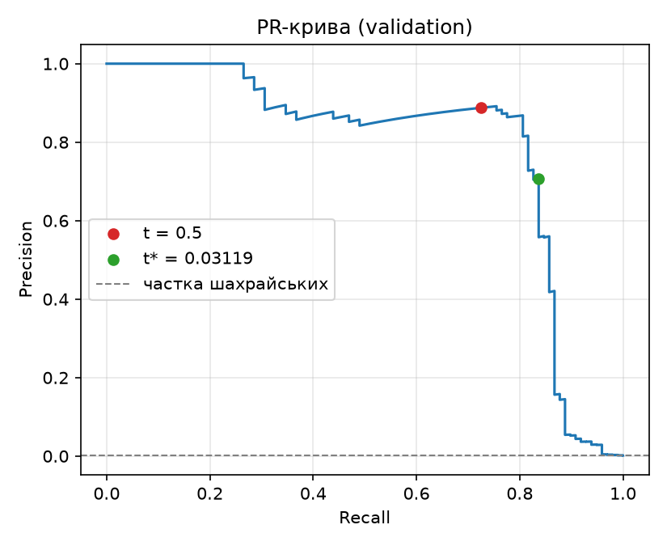
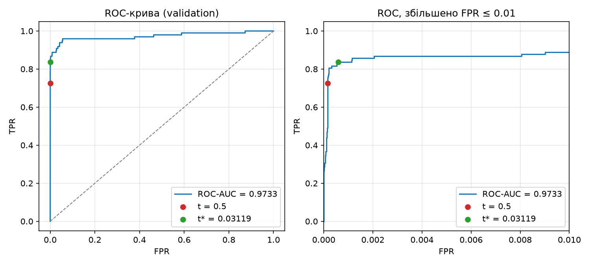

# ЛР2. Який поріг ставити, коли помилки мають різну ціну

У роботі є невелика нейромережа, яка оцінює ймовірність шахрайства для банківської транзакції. Дані: [Credit Card Fraud Detection на Kaggle](https://www.kaggle.com/datasets/mlg-ulb/creditcardfraud), 284 807 транзакцій, з яких 492 шахрайські. Мережу я навчаю один раз і далі не чіпаю. Єдине, що змінюється, це число `t`: вище нього транзакція вважається шахрайською. Мета — знайти `t`, за якого сумарна вартість помилок найменша, де пропущене шахрайство коштує 10, а хибна тривога 1.

## Що де лежить

| Файл або тека | Що це |
|---|---|
| `lab2_starter.py` | код викладача, не змінював: поділ даних, навчання, збереження прогнозів |
| `thresholds.py` | мій код: лічильники TP/FP/FN/TN, вартість, швидкий пошук порога, повільний перебір для перевірки |
| `analyze.py` | мій код: пункти 2–4 завдання (криві, пошук `t*`, три перевірки, test, помилки) |
| `test_thresholds.py` | додаткова самоперевірка `thresholds.py` на випадкових малих наборах |
| `compare_runs.py` | порівнює два запуски навчання між собою |
| `pyproject.toml`, `uv.lock`, `.python-version` | Python 3.12 і зафіксовані версії бібліотек |
| `results/` | вага моделі, збережені прогнози, параметри scaler, журнал навчання |
| `analysis/` | все, що видає `analyze.py`: криві, таблиці, поріг, перевірки, помилки |

## Як запустити

`creditcard.csv` у репозиторії немає. Його можна скачати з Kaggle (потрібен акаунт), а шлях до файлу передається в команду навчання через `--data`.

```bash
uv sync

# навчання: один раз, тека --out має бути порожньою або не існувати
uv run python lab2_starter.py --data "/шлях/до/creditcard.csv" --out results

# аналіз зі збережених прогнозів: CSV і навчання не потрібні
uv run python analyze.py --saved results --out analysis
```

Ще дві корисні команди:

```bash
uv run python test_thresholds.py   # самоперевірка алгоритму пошуку

# повторне навчання в іншу теку та порівняння з першим запуском
uv run python lab2_starter.py --data "/шлях/до/creditcard.csv" --out results_rerun
uv run python compare_runs.py --a results --b results_rerun
```

Команда аналізу дає всі числа з цього звіту. Повторне навчання дає той самий поділ даних і ті самі параметри scaler (це перевіряє `compare_runs.py`), а от оцінки моделі можуть трохи відрізнятися в останніх знаках через версію PyTorch і платформу. Тому всі висновки нижче зроблено саме за збереженими прогнозами з `results/`.

Версії: Python 3.12.14, numpy 2.5.3, pandas 3.0.6, scikit-learn 1.9.1, torch 2.14.1 (повний перелік у `uv.lock`).

## 1. Підготовка даних і навчання

На вхід моделі йдуть 29 ознак: `V1`–`V28` та `Amount`. Стовпці `Class` (мітка) і `Time` у модель не потрапляють. Початкове значення `Amount` я окремо зберігаю: воно знадобиться, щоб розглянути помилки.

Дані ділю на три частини зі збереженням початкового порядку рядків і однаковою часткою шахрайства в кожній:

1. `train_test_split` над індексами з `test_size=0.4`, `stratify=Class`, `random_state=0` відокремлює 60% під навчання;
2. решту 40% так само ділю навпіл (`test_size=0.5`, стратифікація за мітками цих рядків, `random_state=0`): перша половина — validation, друга — test.

| Частина | Скільки транзакцій | З них шахрайських | Частка |
|---|---|---|---|
| train | 170 884 | 295 | 0.1726% |
| validation | 56 961 | 98 | 0.1720% |
| test | 56 962 | 99 | 0.1738% |

Шахрайство дуже рідкісне: у кожній частині його близько 0.17%.

**Чому scaler рахується тільки на train.** Якщо взяти середнє й відхилення за всіма даними, у них потраплять і значення з validation та test. Тоді те, на чому ми пізніше перевіряємо модель, вже вплинуло на підготовку даних, і результат виходить кращим, ніж буде на нових транзакціях. Це називають витоком даних. У реальному житті майбутніх транзакцій на момент навчання ще немає, тому статистики можна брати лише з train, а до validation і test застосовувати ті самі.

**Навчання.** Мережа `Linear(29,32) → ReLU → Linear(32,1)`, втрати `BCEWithLogitsLoss` без ваг для класів, Adam із кроком `1e-3`, 12 епох, пакет 1024 (останній неповний пакет теж використовується), CPU, float32. Початкове зерно `torch.manual_seed(0)`, а порядок прикладів кожної епохи задає окремий `np.random.default_rng(0)`. Беру ваги після 12-ї епохи, без вибору епохи за validation. Втрата на train зменшилась з 0.3653 до 0.003383 (`results/train_log.txt`). Оцінки `s = sigmoid(z)` для validation і test зберігаю без округлення.

## 2. Пошук порога на validation

### Формули

Транзакція позначається як шахрайська, якщо `s ≥ t`. Тоді:

- **TP** — шахрайські, які ми так і позначили; **FN** — шахрайські, які пропустили;
- **FP** — чесні, яких позначили шахрайськими (хибна тривога); **TN** — чесні, яких не чіпали;
- вартість `C(t) = 10·FN(t) + FP(t)`; сума `Amount` у неї не входить;
- `precision = TP/(TP+FP)`, `recall = TP/(TP+FN)`, `FPR = FP/(FP+TN)`.

Лічильники та вартість написані мною (`thresholds.confusion`, `thresholds.cost`). Із scikit-learn беру лише побудову кривих і ROC-AUC.

### Криві та ROC-AUC





На графіках позначено пороги 0.5 та `t*`. Права панель ROC — збільшення області `FPR ≤ 0.01`, бо обидві точки лежать у самому куті. **ROC-AUC на validation: 0.9733.**

**Чому велика ROC-AUC ще не означає, що помилки дешеві або що точність висока.**

- ROC-AUC каже, наскільки добре модель упорядковує транзакції: з якою ймовірністю випадкове шахрайство отримає оцінку вищу, ніж випадкова чесна транзакція. Це число не залежить від вибраного порога, а вартість залежить. Модель має одну AUC, але три різні вартості: 279 при порозі 0.5, 194 при `t*` і 980, якщо нічого не позначати.
- Чесних транзакцій дуже багато (56 863), тому 34 хибні тривоги дають `FPR` лише близько 0.0006, і крива ROC біля цієї точки майже ідеальна. А precision рахується серед спрацювань: `82/(82+34) ≈ 0.707`, тобто приблизно кожна третя тривога насправді хибна.
- ROC-AUC ставиться до обох видів помилок однаково, тоді як у нашій вартості пропуск шахрайства в десять разів гірший.

### Як шукається поріг

Кандидатами є всі різні оцінки з validation та `+∞` (означає «нічого не позначати»; найменша оцінка означає «позначати все»). Таблицю кандидатів будує `thresholds.candidate_table` за час `O(n log n)`:

1. Оцінки сортуються від більшої до меншої, мітки переставляються разом із ними.
2. Накопичувана сума міток показує, скільки шахрайств серед `k` найвищих оцінок. Це й є `TP`, якщо порог ставити так, щоб ці `k` об'єктів були позначені.
3. Рівні оцінки не можна розділяти: правило `s ≥ t` або бере всі об'єкти з однаковою оцінкою, або жодного. Тому значення накопичених сум беруться лише в **останній позиції** кожної групи однакових оцінок.
4. Окремим рядком додається `+∞` з `TP = FP = 0`. Інші лічильники виводяться з формул: `FP = k − TP`, `FN = P − TP`, `TN = N − FP`, де `P` і `N` — кількості шахрайських та чесних.
5. Якщо найменша вартість є в кількох рядках, береться **найбільший** поріг.

Алгоритм проходить дані один раз, а не окремо для кожного порога. Всього на validation 55 983 різні оцінки із 56 961, тобто 978 значень повторюються, тож обробка рівних оцінок має практичний сенс. З `+∞` кандидатів 55 984. Таблиця збережена в `analysis/validation_candidates.csv` з повною точністю, а кількості записані в `analysis/threshold.json`.

Найменша вартість `C = 194` досягається при **`t* = 0.0311939…`** (повне значення в `analysis/threshold.json`). Найкращі кандидати зібрано в `analysis/near_optimal.csv`: поруч із `t*` є пороги 0.0306, 0.0304 і 0.0300 з вартістю 195, 196 і 197, а також 0.0454 з вартістю 198, тобто мінімум доволі пологий.

| Правило на validation | Поріг | TP | FP | FN | TN | C | precision | recall |
|---|---|---|---|---|---|---|---|---|
| Стандартний поріг | 0.5 | 71 | 9 | 27 | 56 854 | 279 | 0.888 | 0.724 |
| Мінімум вартості | t\* ≈ 0.031194 | 82 | 34 | 16 | 56 829 | 194 | 0.707 | 0.837 |
| Усі негативні | +∞ | 0 | 0 | 98 | 56 863 | 980 | не визначена | 0 |

З порогом `t*` знайдено на 11 шахрайств більше, ніж з 0.5 (пропущених стало 16 замість 27), а хибних тривог додалось 25 (34 замість 9). Вигода: `11 · 10 = 110` проти `25`, тобто вартість зменшується на 85. Рядок «усі негативні» показує, скільки коштувало б не користуватися моделлю: усі 98 пропущених шахрайств дають 980.

## 3. Перевірка алгоритму на трьох малих наборах

Щоб переконатись, що швидкий алгоритм не помиляється, я окремо написав повільний. Для кожного кандидата він у звичайному циклі проходить усі елементи й просто застосовує правило `s_i ≥ t`, а потім обирає найкращий рядок з тим самим правилом для нічиєї (`thresholds.brute_force_table` та `brute_force_best`). Повільний код не використовує нічого зі швидкого. Результат однаковий у всіх трьох наборах: лічильники та вартості збігаються точно, пороги ті самі. Таблиці лежать у `analysis/check_A.csv`, `check_B.csv`, `check_C.csv`, підсумок у `checks_summary.csv`. Крім того, `test_thresholds.py` порівнює два алгоритми ще на 2000 випадкових наборах, де багато рівних оцінок, а іноді взагалі немає шахрайства. Аналіз test у `analyze.py` запускається лише коли всі три перевірки пройшли.

**Набір A.** `s = [0.9, 0.7, 0.7, 0.4, 0.2, 0.1]`, `y = [0, 1, 0, 1, 0, 0]`. Обраний поріг **0.4**, `C = 2`.

| Поріг | TP | FP | FN | TN | C |
|---|---|---|---|---|---|
| +∞ | 0 | 0 | 2 | 4 | 20 |
| 0.9 | 0 | 1 | 2 | 3 | 21 |
| 0.7 | 1 | 2 | 1 | 2 | 12 |
| 0.4 | 2 | 2 | 0 | 2 | 2 |
| 0.2 | 2 | 3 | 0 | 1 | 3 |
| 0.1 | 2 | 4 | 0 | 0 | 4 |

Тут дві однакові оцінки 0.7 мають різні мітки. Це перевірка, що вони йдуть разом як один кандидат: при `t = 0.7` позначаються обидва, `TP` стає 1 і `FP` стає 2 одночасно. Якби ми рахували їх по черзі, вийшов би стан, у якому з двох однакових оцінок одна позначена, а інша ні, а так бути не може.

**Набір B.** `s = [0.9, 0.6, 0.3]`, `y = [0, 0, 0]`. Обраний поріг **+∞**, `C = 0`.

| Поріг | TP | FP | FN | TN | C |
|---|---|---|---|---|---|
| +∞ | 0 | 0 | 0 | 3 | 0 |
| 0.9 | 0 | 1 | 0 | 2 | 1 |
| 0.6 | 0 | 2 | 0 | 1 | 2 |
| 0.3 | 0 | 3 | 0 | 0 | 3 |

Шахрайств немає зовсім, тож будь-яке спрацювання — це хибна тривога, і найвигідніше не позначати нічого. Набір показує, навіщо потрібен кандидат `+∞`: без нього найкращим вийшов би 0.9 із `C = 1`. У цьому наборі recall дорівнює `0/0` при будь-якому порозі (позитивних немає), а при `+∞` ще й precision дорівнює `0/0` (спрацювань немає). Для пошуку це не заважає, бо вартість цих дробів не використовує.

**Набір C.** `s = [0.8, 0.5 × 11, 0.2]`, `y = [1, 1, 0 × 10, 0]`: одинадцять оцінок 0.5 підряд, перша з міткою 1, решта десять з міткою 0. Обраний поріг **0.8**, `C = 10`.

| Поріг | TP | FP | FN | TN | C |
|---|---|---|---|---|---|
| +∞ | 0 | 0 | 2 | 11 | 20 |
| 0.8 | 1 | 0 | 1 | 11 | 10 |
| 0.5 | 2 | 10 | 0 | 1 | 10 |
| 0.2 | 2 | 11 | 0 | 0 | 11 |

Тут дві перевірки. Перша: у порогів 0.8 і 0.5 однакова вартість 10, тож працює правило нічиєї, і береться більший, 0.8. Друга: одинадцять однакових оцінок 0.5 мають враховуватися цілою групою. Якщо взяти лічильники на першому елементі групи, вийде неможливе `TP = 2, FP = 0`, `C = 0`, якого жоден реальний поріг не дає.

## 4. Оцінка на test

Поріг `t*`, знайдений на validation, без змін застосовано до test. Ні поріг, ні модель, ні налаштування навчання після погляду на test не змінювались.

| | позначено шахрайством | не позначено |
|---|---|---|
| **справді шахрайство (99)** | TP = 80 | FN = 19 |
| **справді чесна (56 863)** | FP = 43 | TN = 56 820 |

- вартість `C = 10·19 + 43 = 233`;
- `precision = 80/(80+43) ≈ 0.650`;
- `recall = 80/(80+19) ≈ 0.808`.

Для порівняння: на test з порогом 0.5 вартість була б 288, а якщо нічого не позначати — 990.

**Коли precision або recall не існують.** Precision ділить на кількість спрацювань `TP+FP`. Якщо модель нічого не позначила (наприклад, `t = +∞`), ділити нема на що. Recall ділить на кількість справжніх шахрайств `TP+FN`: якщо їх у вибірці немає, як у наборі B, він теж не визначений. На test обидві метрики визначені.

### Перші п'ять хибних тривог і п'ять пропусків

Рядки відсортовано за номером у CSV (від 0, без заголовка):

| Рядок CSV | Тип | Мітка | Оцінка s | Amount | s − t\* |
|---|---|---|---|---|---|
| 460 | FP | 0 | 0.1962 | 2.00 | +0.1650 |
| 2961 | FP | 0 | 0.0810 | 2.49 | +0.0498 |
| 10783 | FP | 0 | 0.9663 | 89.99 | +0.9351 |
| 13405 | FP | 0 | 0.9320 | 89.99 | +0.9008 |
| 13617 | FP | 0 | 0.9228 | 89.99 | +0.8916 |
| 10497 | FN | 1 | 0.0115 | 3.79 | −0.0197 |
| 52521 | FN | 1 | 0.0064 | 105.99 | −0.0248 |
| 55401 | FN | 1 | 0.0056 | 1.00 | −0.0256 |
| 91671 | FN | 1 | 0.0005 | 290.18 | −0.0307 |
| 93486 | FN | 1 | 0.0184 | 0.00 | −0.0128 |

Тут округлено тільки для показу, точні значення в `analysis/test_errors.csv`.

**Порівняння Amount.** Серед хибних тривог суми 2.00, 2.49 і тричі 89.99 (медіана 89.99). Серед пропусків суми від 0.00 до 290.18 (медіана 3.79). Чіткої різниці між двома групами в цих прикладах немає.

**Порівняння відстаней до порога.** Хибні тривоги далеко над порогом: у середньому на 0.588, а три з п'яти мають оцінку 0.92–0.97. Тобто модель була майже певна, і підняти чи опустити поріг, щоб їх прибрати, не вийде. Пропуски лежать трохи нижче порога (в середньому на 0.023), але самі оцінки в них крихітні, 0.0005–0.018, тож вони в рази менші за `t*`. Щоб їх зловити, поріг треба було б сильно опустити, а це додало б багато хибних тривог.

**Чи можна за десятьма прикладами робити висновок про причину помилок?** Не можна. Це просто перші помилки за номером рядка, а не випадкова вибірка, тому вони можуть не бути типовими. Три однакові суми 89.99 можуть бути випадковістю. До того ж ознаки `V1`–`V28` анонімні, і зрозуміти, що саме в них не так, неможливо, а `Amount` — лише одна з 29 ознак. Щоб щось стверджувати, треба розглянути всі 62 помилки й порівняти їх із правильно оціненими транзакціями. Десять прикладів годяться хіба що для гіпотез.

## Висновки

**Що дало використання порога.** Модель і її оцінки не змінились, змінилось лише правило, що з оцінки робить рішення. Оптимальний `t* ≈ 0.031` набагато менший за 0.5, бо пропущене шахрайство коштує вдесятеро більше, ніж хибна тривога, і тому позначати вигідно навіть при невисокій оцінці. На validation вартість упала з 279 до 194, тобто на 30.5%.

**Ціна за це.** Ми дістали на 11 виявлених шахрайств більше (`FN`: 27 → 16) і заплатили 25 додатковими хибними тривогами (`FP`: 9 → 34). Precision впала з 0.888 до 0.707, а recall виросла з 0.724 до 0.837. На test з порогом `t*` маємо `FN = 19`, `FP = 43`, `C = 233` проти 288 для порога 0.5, тобто економія 55 (19.1%) замість 85 на validation.

**Чому виграш на validation не обіцяє такого самого виграшу на test.** Поріг `t*` вибрано так, щоб вартість була найменшою саме на validation, тобто він частково підігнаний під ті конкретні 98 шахрайств. Знайдений там мінімум трохи кращий, ніж загалом можна очікувати, бо ми взяли найкращий із десятків тисяч варіантів. До того ж шахрайств у вибірці мало, і один зайвий пропуск додає 10 до вартості, тож результат дуже залежить від кількох окремих транзакцій. На test інші 99 шахрайств, тому вартість там (233) вища, ніж найкраща на validation (194). Це нормальний розкид між двома незалежними вибірками такого розміру, а не помилка. Щоб оцінити, наскільки виграш надійний, знадобилися б довірчі інтервали (наприклад, бутстреп) або більше шахрайських прикладів.

## Джерела та інструменти

- `lab2_starter.py` надано викладачем, використаний без змін.
- Документація scikit-learn (`train_test_split`, `StandardScaler`, `roc_curve`, `roc_auc_score`, `precision_recall_curve`), NumPy (`argsort`, `cumsum`), PyTorch (`BCEWithLogitsLoss`, `Adam`).
- Набір даних: Machine Learning Group, ULB, [Credit Card Fraud Detection](https://www.kaggle.com/datasets/mlg-ulb/creditcardfraud), Kaggle.
- Генеративний помічник Claude (Anthropic) допомагав із написанням коду аналізу та оформленням цього звіту. Усі результати відтворюються описаними командами, а формули, алгоритм і перевірки я можу пояснити самостійно.
